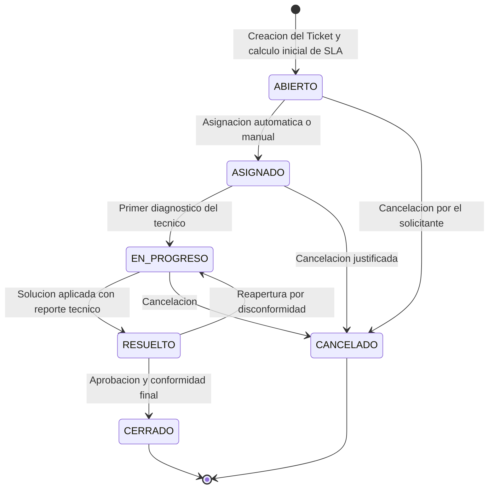

# HelpFlow - Sistema Integral de Gestion de Soporte TI

HelpFlow es una plataforma empresarial orientada a la gestion, priorizacion, asignacion determinista, escalamiento y trazabilidad de tickets de soporte tecnico en entornos corporativos distribuidos.

---

## 1. Descripcion del Sistema y Arquitectura

El ecosistema esta desarrollado con Java 21 y Spring Boot 3.4.4, implementando el patron de Arquitectura Hexagonal (Ports & Adapters) para desacoplar las reglas de negocio del framework, interfaces de comunicacion y mecanismos de persistencia.

El sistema se compone de dos microservicios y una base de datos relacional:

1. **support-ticket-service (Puerto 8080):**
   - Servicio central encargado de la autenticacion (JWT), creacion, seguimiento, escalamiento, transicion de estados y registro de auditoria de los tickets.
   - Aplica validaciones de dominio segun reglas de negocio y Acuerdos de Nivel de Servicio (SLA).
   - Se comunica con el servicio de despacho para resolver la asignacion tecnica determinista.
   - Gestiona migraciones de base de datos automatizadas con Flyway sobre PostgreSQL.

2. **technician-dispatch-service (Puerto 8081):**
   - Microservicio ligero especializado en el calculo de disponibilidad y asignacion tecnica.
   - Ejecuta un algoritmo determinista parametrizado por semillas (seed) para evaluar la carga de trabajo, disponibilidad horaria, especialidad requerida y sede fisica.

3. **PostgreSQL 16 (Puerto expuesto 5433 / interno 5432):**
   - Motor de persistencia relacional configurado para almacenar usuarios, roles, perfiles tecnicos, tickets, historial de transiciones y logs de escalamiento.

### Diagrama de Arquitectura de Componentes

```mermaid
flowchart LR
    subgraph Clientes [Clientes / Interfaces]
        Postman[Postman / Aplicacion Web]
    end

    subgraph SupportService [support-ticket-service :8080]
        direction TB
        subgraph AdaptersIn [Adaptadores de Entrada]
            REST[Controladores REST y Filtro JWT]
        end

        subgraph PortsIn [Puertos de Entrada]
            InputPorts[ManageTicketUseCase / ManageUserUseCase]
        end

        subgraph CoreDomain [Nucleo de Dominio]
            DomainModel[Ticket, User, Technician, TicketHistory]
            BusinessRules[Reglas de SLA, Transiciones y Asignacion]
        end

        subgraph PortsOut [Puertos de Salida]
            OutputPorts[TicketRepositoryPort / DispatchPort]
        end

        subgraph AdaptersOut [Adaptadores de Salida]
            JPA[Spring Data JPA y PostgreSQL]
            RestClient[Adaptador HTTP RestClient]
        end

        REST --> InputPorts
        InputPorts --> CoreDomain
        CoreDomain --> OutputPorts
        OutputPorts --> JPA
        OutputPorts --> RestClient
    end

    subgraph DispatchService [technician-dispatch-service :8081]
        DispatchController[POST /technician-dispatch]
        DispatchAlgo[Algoritmo Determinista con Semilla]
    end

    subgraph Database [PostgreSQL :5433]
        DB[(helpflow_db)]
    end

    Postman -->|HTTP y Bearer JWT| REST
    RestClient -->|HTTP REST JSON| DispatchController
    DispatchController --> DispatchAlgo
    JPA -->|JDBC y Flyway| DB
```



---

## 2. Requisitos Previos

Antes de ejecutar el proyecto, valide que su entorno cuente con las siguientes herramientas instaladas:

- **Java Development Kit (JDK):** Version 21 (Temurin, OpenJDK u Oracle).
- **Apache Maven:** Version 3.9 o superior (o utilizar el wrapper `./mvnw` incluido).
- **Docker Engine y Docker Compose:** Version 24+ (Docker Compose v2 compatible).
- **Git:** Para control de versiones y clonacion.
- **cURL o Postman:** Para ejecucion de pruebas de endpoints y verificacion de salud.

---

## 3. Configuracion y Variables de Entorno

El proyecto implementa externalizacion de configuracion mediante variables de entorno compatibles con Spring Boot y Docker Compose.

### Archivo .env

Para inicializar la configuracion local, copie la plantilla de ejemplo:

```bash
cp .env.example .env
```

### Detalle de Variables de Configuracion

| Variable | Descripcion | Valor Predeterminado | Entorno Requerido |
| :--- | :--- | :--- | :--- |
| `POSTGRES_DB` | Nombre de la base de datos relacional | `helpflow_db` | Desarrollo / Docker |
| `POSTGRES_USER` | Usuario administrador de PostgreSQL | `postgres` | Desarrollo / Docker |
| `POSTGRES_PASSWORD` | Contrasena del usuario PostgreSQL | `postgrespassword` | Desarrollo / Docker |
| `POSTGRES_PORT` | Puerto de PostgreSQL expuesto al host | `5433` | Host local |
| `SUPPORT_SERVICE_PORT` | Puerto HTTP para support-ticket-service | `8080` | Host local / Docker |
| `TECHNICIAN_DISPATCH_PORT` | Puerto HTTP para technician-dispatch-service | `8081` | Host local / Docker |
| `JWT_SECRET` | Clave secreta para firma HMAC-SHA256 (minimo 256 bits) | Definido por el operador | Produccion / Staging |
| `JWT_EXPIRATION` | Tiempo de expiracion de token en milisegundos | `86400000` (24 horas) | General |
| `TECHNICIAN_DISPATCH_URL` | URL base para invocar el servicio de despacho | `http://technician-dispatch-service:8081` | Inter-servicio |

> [!IMPORTANT]
> **Seguridad de Claves JWT:**
> Nunca almacene claves de produccion en el repositorio ni en `.env.example`. Para generar una clave criptograficamente segura de 256 bits en hexadecimal, ejecute en su terminal:
> ```bash
> openssl rand -hex 32
> ```
> Asigne el valor resultante a la variable `JWT_SECRET` dentro de su archivo `.env` privado.

---

## 4. Guia Paso a Paso de Ejecucion

### Opcion A: Despliegue con Docker Compose (Recomendado)

Esta opcion compila las imagenes y levanta todo el stack de microservicios, redes internas y base de datos con dependencias resueltas y chequeos de salud automatizados.

#### Paso 1: Configurar variables de entorno
Asegurese de que el archivo `.env` exista en la raiz del proyecto:
```bash
cp .env.example .env
```

#### Paso 2: Limpiar posibles contenedores u orfandades previas
Si ya ha ejecutado servicios en su maquina anteriormente, limpie el estado para evitar conflictos de puertos o redes huerfanas:
```bash
docker compose down
```

#### Paso 3: Construir imagenes y levantar los servicios
Ejecute la construccion y arranque en segundo plano:
```bash
docker compose up -d --build
```

#### Paso 4: Validar el estado de los contenedores
Verifique que los 3 contenedores esten arriba y que `helpflow-postgres` reporte estado `(healthy)`:
```bash
docker compose ps
```

Salida esperada:
- `helpflow-postgres`: Status `Up (healthy)`, Puerto `0.0.0.0:5433->5432/tcp`
- `technician-dispatch-service`: Status `Up`, Puerto `0.0.0.0:8081->8081/tcp`
- `support-ticket-service`: Status `Up`, Puerto `0.0.0.0:8080->8080/tcp`

#### Paso 5: Inspeccionar logs de inicializacion
Para seguir los logs en tiempo real:
```bash
docker compose logs -f support-ticket-service
```
Cuando la aplicacion este lista, observara:
```text
Started SupportTicketApplication in X.XXX seconds
```

#### Paso 6: Detener el ecosistema
Para detener los contenedores preservando los datos de la base de datos:
```bash
docker compose down
```
Para detener los contenedores y reiniciar los datos desde cero (borrando volumenes):
```bash
docker compose down -v
```

---

### Opcion B: Ejecucion Local en Entorno de Desarrollo (Maven)

Si desea depurar codigo o correr los servicios localmente sin empaquetar en imagenes Docker:

#### Paso 1: Iniciar unicamente la base de datos PostgreSQL
Puede levantar unicamente el contenedor de base de datos desde docker-compose:
```bash
docker compose up -d db
```
O conectarse a una instancia local de PostgreSQL que corra en el puerto `5433` con base de datos `helpflow_db`, usuario `postgres` y clave `postgrespassword`.

#### Paso 2: Compilar el proyecto raiz
Desde la carpeta raiz del proyecto, compile y resuelva las dependencias de todos los modulos:
```bash
./mvnw clean compile -DskipTests
```

#### Paso 3: Iniciar technician-dispatch-service (Terminal 1)
```bash
cd technician-dispatch-service
../mvnw spring-boot:run
```
El servicio quedara escuchando peticiones en `http://localhost:8081`.

#### Paso 4: Iniciar support-ticket-service (Terminal 2)
En una nueva terminal, ejecute:
```bash
cd support-ticket-service
../mvnw spring-boot:run
```
Al iniciar, Flyway ejecutara automaticamente las migraciones `V1`, `V2` y `V3` en PostgreSQL y el servicio quedara disponible en `http://localhost:8080`.

---

## 5. Verificacion y Estado del Sistema

Una vez iniciado el sistema, valide los endpoints de chequeo y observabilidad:

### Comprobacion de Salud (Healthcheck)
```bash
curl -s http://localhost:8080/actuator/health
```
Respuesta esperada:
```json
{
  "status": "UP",
  "components": {
    "db": {
      "status": "UP",
      "details": {
        "database": "PostgreSQL",
        "validationQuery": "isValid()"
      }
    },
    "diskSpace": {
      "status": "UP"
    },
    "ping": {
      "status": "UP"
    }
  }
}
```

### Metricas Prometheus
```bash
curl -s http://localhost:8080/actuator/prometheus
```

### Documentacion Swagger UI y OpenAPI
- **Interfaz Interactiva Swagger:** [http://localhost:8080/swagger-ui.html](http://localhost:8080/swagger-ui.html)
- **Especificacion OpenAPI v3 JSON:** [http://localhost:8080/v3/api-docs](http://localhost:8080/v3/api-docs)

---

## 6. Pruebas Automatizadas y Cobertura de Codigo

El proyecto cuenta con suites de pruebas unitarias y de integracion desarrolladas con JUnit 5, Mockito y Spring Boot Test, verificando logica de dominio, transiciones de estados y filtros de seguridad.

### Ejecutar todas las pruebas
Para correr el conjunto completo de tests y generar reportes de cobertura JaCoCo:
```bash
./mvnw test
```

### Reportes de Cobertura Generados
Los reportes HTML generados por JaCoCo se ubican en:
- `support-ticket-service/target/site/jacoco/index.html`
- `technician-dispatch-service/target/site/jacoco/index.html`

Para abrir el reporte en su navegador:
```bash
xdg-open support-ticket-service/target/site/jacoco/index.html
```

---

## 7. Usuarios Semilla y Matriz de Roles

La base de datos se inicializa mediante la migracion `V3__datos_iniciales.sql` con usuarios preconfigurados. Todas las contrasenas por defecto estan cifradas con algoritmo BCrypt:

| Rol | Correo Electronico | Contrasena | Descripcion de Permisos |
| :--- | :--- | :--- | :--- |
| `ROLE_ADMIN` | `admin@helpflow.com` | `admin123` | Administracion global, reasignacion forzada, gestion de tecnicos, escalamiento manual y visualizacion total. |
| `ROLE_USUARIO` | `carlos.perez@helpflow.com` | `admin123` | Emision de tickets, consulta exclusiva de sus propios tickets creados. |
| `ROLE_USUARIO` | `laura.gomez@helpflow.com` | `admin123` | Emision de tickets, consulta de sus tickets asignados como solicitante. |
| `ROLE_TECNICO` | `mateo.redes@helpflow.com` | `admin123` | Gestion de tickets asignados a su perfil, transicion de estados e insercion de notas tecnicas. |

---

## 8. Flujo de Trabajo y Coleccion de Postman

El repositorio incluye la coleccion oficial de pruebas en el archivo [`postman_collection.json`](./postman_collection.json).

### Procedimiento de Uso en Postman

1. **Importar Coleccion:**
   Abra Postman, seleccione **Import** y elija el archivo `postman_collection.json` ubicado en la raiz de este repositorio.

2. **Flujo de Autenticacion:**
   - Ejecute la peticion `POST /api/v1/auth/login` enviando las credenciales de uno de los usuarios semilla (por ejemplo `admin@helpflow.com` y `admin123`).
   - El script de pruebas de la peticion capturara automaticamente el token JWT del cuerpo de respuesta y lo asignara a la variable de entorno `token`.

3. **Ejecucion de Endpoints Protegidos:**
   Todas las demas peticiones de la coleccion heredan el encabezado `Authorization: Bearer {{token}}`, permitiendo probar:
   - Registro de tickets (`POST /api/v1/tickets`)
   - Asignacion automatica (`POST /api/v1/tickets/{id}/assign`)
   - Transiciones de estado (`PATCH /api/v1/tickets/{id}/status`)
   - Filtros de busqueda paginados (`GET /api/v1/tickets`)
   - Consultas de historial y auditoria (`GET /api/v1/tickets/{id}/history`)

---

## 9. Reglas de Negocio, Estados y SLA

### Maquina de Estados de los Tickets

Toda transicion de estado esta encapsulada y protegida en el agregado de Dominio. Cualquier transicion invalida es rechazada con codigo HTTP 400 y formato ProblemDetail (RFC 7807):



### Politicas de SLA y Escalamiento Preventivo

El vencimiento de cada ticket se calcula al momento de su creacion tomando en cuenta la prioridad inicial:

| Prioridad | Plazo Limite SLA | Regla de Escalamiento Preventivo |
| :--- | :---: | :--- |
| **BAJA** | 48 horas | Si restan 2 horas o menos para el vencimiento, escala a **MEDIA**. |
| **MEDIA** | 24 horas | Si restan 2 horas o menos para el vencimiento, escala a **ALTA**. |
| **ALTA** | 8 horas | Si restan 2 horas o menos para el vencimiento, escala a **CRITICA**. |
| **CRITICA** | 2 horas | Se mantiene en **CRITICA** con alerta maxima en colas de despacho. |

### Criterios de Asignacion Tecnica (technician-dispatch-service)
1. **Compatibilidad:** La especialidad registrada del tecnico debe coincidir con la categoria del ticket (`HARDWARE`, `SOFTWARE`, `RED`, `ACCESOS`, `OTRO`).
2. **Carga Operativa Maxima:** Un tecnico no puede tener mas de 5 tickets activos simultaneamente.
3. **Proximidad de Sede:** Se pondera positivamente a aquellos tecnicos que pertenezcan a la misma sede del solicitante.
4. **Calculo Determinista de Disponibilidad:** Evaluacion mediante algoritmo con semilla controlada para garantizar reproducibilidad en pruebas.

---

## 10. Resolucion de Problemas Frecuentes

### Error: UnknownHostException: db o ConnectionFactoryImpl
- **Causa:** El contenedor de base de datos no esta conectado a la red de Docker Compose o la red bridge esta desincronizada.
- **Solucion:** Ejecute `docker compose down` y vuelva a iniciar con `docker compose up -d --build`.

### Error: Port 5433 or 8080 is already in use
- **Causa:** Hay otra instancia de PostgreSQL o servicio Tomcat ejecutandose en su sistema operativo en el mismo puerto.
- **Solucion:** Modifique la variable `POSTGRES_PORT` o `SUPPORT_SERVICE_PORT` en su archivo `.env` o detenga el proceso que ocupa el puerto mediante `fuser -k 5433/tcp` o `fuser -k 8080/tcp`.

### Error: Flyway Migration Validation Failed
- **Causa:** Los scripts SQL en `src/main/resources/db/migration` fueron modificados despues de haber sido ejecutados en la base de datos existente.
- **Solucion:** En entorno de desarrollo, restablezca el volumen de datos ejecutando `docker compose down -v` seguido de `docker compose up -d --build`.
