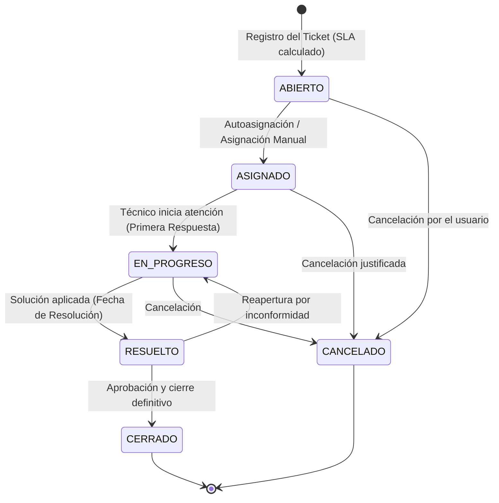

# 🚀 HelpFlow - Sistema Integral de Gestión de Soporte TI

HelpFlow es una plataforma empresarial para la gestión, priorización, asignación determinista, escalamiento y trazabilidad de tickets de soporte técnico en entornos distribuidos.

---

## 🏛️ Arquitectura del Sistema

El ecosistema está construido bajo **Arquitectura Hexagonal (Ports & Adapters)** y compuesto por dos microservicios:

```mermaid
flowchart LR
    subgraph Cliente [Clientes / Frontend]
        Postman[Postman / SPA]
    end

    subgraph SupportService [support-ticket-service :8080]
        direction TB
        subgraph AdaptersIn [Adaptadores de Entrada]
            REST[Controladores REST & JWT Filter]
        end

        subgraph PortsIn [Puertos de Entrada]
            InputPorts[ManageTicketUseCase / ManageUserUseCase]
        end

        subgraph CoreDomain [Dominio Puro]
            DomainModel[Ticket, User, Technician, TicketHistory]
            BusinessRules[Reglas de SLA, Transiciones y Asignación]
        end

        subgraph PortsOut [Puertos de Salida]
            OutputPorts[TicketRepositoryPort / DispatchPort]
        end

        subgraph AdaptersOut [Adaptadores de Salida]
            JPA[Spring Data JPA + PostgreSQL]
            RestClient[HTTP RestClient Adapter]
        end

        REST --> InputPorts
        InputPorts --> CoreDomain
        CoreDomain --> OutputPorts
        OutputPorts --> JPA
        OutputPorts --> RestClient
    end

    subgraph DispatchService [technician-dispatch-service :8081]
        DispatchController[POST /technician-dispatch]
        DispatchAlgo[Algoritmo Determinista con Seed]
    end

    subgraph Database [PostgreSQL :5433]
        DB[(helpflow_db)]
    end

    Postman -->|HTTP + JWT| REST
    RestClient -->|HTTP REST| DispatchController
    DispatchController --> DispatchAlgo
    JPA -->|JDBC / Flyway| DB
```



---

## 🔄 Ciclo de Vida del Ticket (Máquina de Estados)

Las transiciones están protegidas por el modelo de dominio. Todo intento de salto inválido retorna una excepción capturada por el manejador global en formato **RFC 7807 (ProblemDetail)**:



---

## ⏱️ Reglas de Negocio y SLA (Acuerdos de Nivel de Servicio)

| Prioridad | Horas de SLA | Regla de Escalamiento Automático |
| :--- | :---: | :--- |
| **BAJA** | 48 horas | Si faltan $\le$ 2 horas para vencer, escala a **MEDIA**. |
| **MEDIA** | 24 horas | Si faltan $\le$ 2 horas para vencer, escala a **ALTA**. |
| **ALTA** | 8 horas | Si faltan $\le$ 2 horas para vencer, escala a **CRÍTICA**. |
| **CRÍTICA** | 2 horas | Se mantiene en **CRÍTICA** con máxima prioridad en cola. |

### Criterios de Selección y Asignación Técnica:
1. **Disponibilidad:** El microservicio `technician-dispatch-service` genera un seed determinista y calcula la disponibilidad:
   - 0–2 horas $\rightarrow$ `DISPONIBILIDAD ALTA`
   - 3–8 horas $\rightarrow$ `DISPONIBILIDAD MEDIA`
   - Más de 8 horas $\rightarrow$ `DISPONIBILIDAD BAJA`
2. **Compatibilidad:** La especialidad del técnico debe coincidir con la categoría del ticket (`HARDWARE`, `SOFTWARE`, `RED`, `ACCESOS`, `OTRO`).
3. **Carga Máxima:** No se asignan tickets si el técnico ya tiene 5 tickets activos en paralelo.
4. **Criterio de Sede:** Se priorizan técnicos que compartan la misma sede del ticket.

---

## 👥 Roles y Credenciales Semilla (Seed Data)

Las contraseñas de los usuarios semilla están cifradas con BCrypt (`admin123`):

| Rol | Correo Corporativo | Contraseña | Permisos |
| :--- | :--- | :--- | :--- |
| **ROLE_ADMIN** | `admin@helpflow.com` | `admin123` | Acceso total, reasignación, gestión de técnicos y escalamiento. |
| **ROLE_USUARIO** | `carlos.perez@helpflow.com` | `admin123` | Crear tickets, ver únicamente sus propios tickets. |
| **ROLE_USUARIO** | `laura.gomez@helpflow.com` | `admin123` | Crear tickets, consultar sus tickets. |
| **ROLE_TECNICO** | `mateo.redes@helpflow.com` | `admin123` | Consultar tickets asignados a él y cambiar sus estados con observaciones. |

---

## 🚀 Instrucciones de Ejecución

### Opción 1: Con Docker Compose (Recomendada)
Para levantar todo el ecosistema (PostgreSQL en `5433`, Dispatch en `8081` y Support en `8080`):

```bash
docker compose up --build
```

### Opción 2: Ejecución Local en Entorno de Desarrollo

1. **Asegúrate de tener PostgreSQL corriendo** en el puerto `5433` con base de datos `helpflow_db`.
2. **Compilar y empaquetar ambos servicios:**
   ```bash
   mvn clean package -DskipTests
   ```
3. **Iniciar `technician-dispatch-service` (Terminal 1):**
   ```bash
   cd technician-dispatch-service
   mvn spring-boot:run
   ```
4. **Iniciar `support-ticket-service` (Terminal 2):**
   ```bash
   cd support-ticket-service
   mvn spring-boot:run
   ```

---

## 📖 Documentación Interactiva y Colección de Pruebas

- **Swagger UI:** [http://localhost:8080/swagger-ui.html](http://localhost:8080/swagger-ui.html)
- **OpenAPI JSON:** [http://localhost:8080/v3/api-docs](http://localhost:8080/v3/api-docs)
- **Colección de Postman:** Importa el archivo [`postman_collection.json`](file:///home/yamitgc/Desktop/SpringBoot/HelpFlow/postman_collection.json) que se encuentra en la raíz del repositorio.

---

## 📈 Observabilidad y Métricas (Micrometer + Actuator)

- **Salud del Sistema:** `GET /actuator/health`
- **Métricas Generales:** `GET /actuator/metrics`
- **Métricas Prometheus:** `GET /actuator/prometheus`

### Métricas de Negocio Personalizadas:
- `helpflow_tickets_created_total`: Contador con etiquetas `categoria` y `prioridad`.
- `helpflow_ticket_first_response_duration`: Temporizador hasta la primera respuesta técnica.
- `helpflow_ticket_resolution_duration`: Temporizador hasta la resolución del ticket.
- `helpflow_tickets_expired_total`: Contador de tickets vencidos fuera del SLA.
- `helpflow_auth_failures_total` & `helpflow_access_denied_total`: Seguridad y auditoría.
